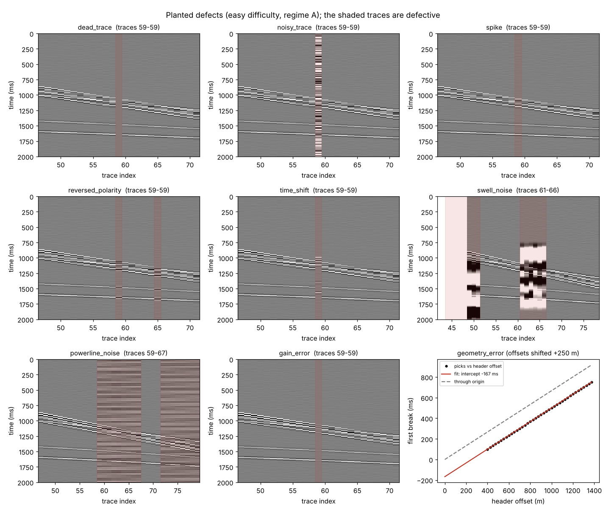
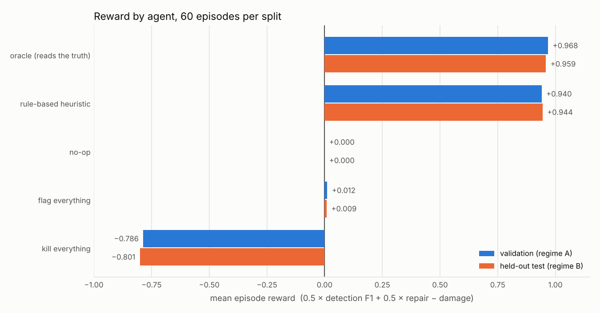
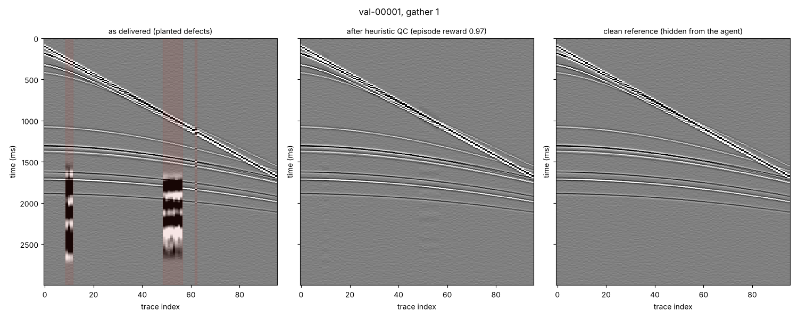

# Seismic QC Gym

A training and evaluation environment for tool-using AI agents that quality-control pre-stack seismic data.

Each episode is a seeded 2D marine line with planted acquisition defects and exact ground truth. Agents work only through QC tools, which are also served over the Model Context Protocol (MCP). A programmatic grader scores what they find, how well they repair it, and any damage they do to healthy data.

**Run it yourself:** installation, reproducing the results, running an LLM agent and connecting an MCP client are covered step by step in [docs/RUNNING.md](docs/RUNNING.md).



## Why

Field-data QC before processing is high-volume, repetitive and checkable. A trace is either dead or it isn't, and header offsets either agree with the first breaks or they don't. That makes QC a good setting for agents that plan, call tools and re-check their work. It also allows training those agents on verifiable rewards rather than human labels.

Working on this needs three things, and this repository provides each:

- an environment with known ground truth;
- tools an agent can call;
- graders that trivial policies cannot game.

## What is inside

| Part | File | What it does |
|---|---|---|
| Synthetic surveys | `synth.py` | Marine streamer shot gathers: a direct wave, a water-bottom reflection and its multiple, and hyperbolic primaries. Built from a Ricker wavelet with band-limited noise and trace coupling variation. |
| Defect catalogue | `defects.py` | Nine defect types from standard trace-editing practice, planted with exact parameters at three difficulty levels. |
| QC measurements | `qc.py`, `fixes.py` | Amplitude attributes, neighbour cross-correlation, spectra, first-break picking with a robust offset fit, and the repair operators. |
| Environment | `env.py` | Episodes, 12 tools, a call budget, trajectory logging and grading on submit. |
| Grader | `grading.py` | Detection F1, repair quality, damage and a scalar reward. |
| Agents | `agents/` | An oracle (ceiling), a rule-based heuristic, a tool-calling LLM agent (any OpenAI-compatible endpoint, optional images) and three degenerate policies. |
| MCP server | `mcp_server.py` | The same tools for any MCP client. |
| Evaluation | `eval.py` | Runs an agent over a split and writes per-episode results, trajectories and summary tables. |

### Defect catalogue

| Defect | How it is planted | What reveals it | Fix |
|---|---|---|---|
| `dead_trace` | Zeros, or near-zero noise on hard | RMS far below neighbours | `kill` |
| `noisy_trace` | Strong broadband noise | Loud and incoherent with neighbours | `kill` |
| `spike` | 1–3 single-sample glitches | Spike index (an isolated outlier against its local window) | `despike` |
| `reversed_polarity` | Trace multiplied by −1 | Negative correlation with neighbours on both sides | `flip_polarity` |
| `time_shift` | Whole trace delayed or advanced | Lag relative to neighbours after local moveout cancels | `shift` |
| `swell_noise` | Low-frequency (<5 Hz) bursts on 3–8 adjacent traces | Energy below 6 Hz | `lowcut` |
| `powerline_noise` | A 50 Hz tone on 4–12 adjacent traces | Narrow-band 50 Hz line in the late record | `notch` |
| `gain_error` | Trace scaled up or down | RMS off against adjacent and local neighbours, waveform intact | `rescale` |
| `geometry_error` | Every header offset in a gather shifted by whole group intervals | Direct-wave first breaks fit with a non-zero intercept | `offset_shift` |

The catalogue follows the preprocessing problems described in Yilmaz, *Seismic Data Analysis* (SEG): noisy traces and transient glitches, polarity reversals, swell noise, monofrequency noise and field-geometry errors. Dead traces, timing errors and bad gain are common additions in field QC.

Difficulty controls how many defects there are and how subtle they are. On `hard`, about 30% of polarity, timing, gain and spike defects come paired with a second defect on the same trace. Finding the second one means checking again after the first fix.

### Tools

| Tool | Returns |
|---|---|
| `survey_summary` | Layout, sampling, header offset ranges, the defect catalogue and the budget |
| `trace_headers` | Channel and header offset per trace |
| `trace_attributes` | RMS against the gather and against adjacent (±2) and local (±6) traces; spike index; zero fraction |
| `neighbour_consistency` | Signed correlation with neighbours on each side and the trace's time shift relative to them |
| `spectrum_check` | Dominant frequency, the ratio of energy below 6 Hz, and the 50 Hz line ratio |
| `first_break_check` | Near-offset first-break picks fitted against header offsets: velocity, intercept and a suggested offset correction |
| `geometry_survey_check` | The first-break fit for every gather, for finding shifted headers |
| `render_gather` | A PNG of a gather or a window of it, for vision-language models |
| `flag_defect`, `remove_flags` | Record or retract a defect |
| `apply_fix` | `kill`, `flip_polarity`, `shift`, `despike`, `lowcut`, `notch`, `rescale`, `offset_shift` |
| `submit_report` | End and grade the episode |

The tools return measurements, never verdicts. Deciding what counts as abnormal is the agent's job: it has to compare each trace with the gather medians and with its neighbours.

### Scoring

The grader scores **items**: one per (gather, trace, type) for trace defects, and one per (gather, type) for a geometry error, so a gather-wide header shift counts once.

| Component | Definition |
|---|---|
| Detection F1 | Over items; the flagged type must match |
| Repair | Per defective trace, the share of the planted error removed: `1 − ‖final − clean‖ / ‖delivered − clean‖`. Dead and noisy traces score 1 if killed. Geometry scores 1 if offsets are restored to within half a group interval. |
| Damage | Change to healthy traces (relative error; 1 for a kill) plus corrupted headers on healthy gathers, divided by the number of true defect items and capped at 1. One wrong fix costs about as much as a right fix earns. |
| Reward | `0.5 × F1 + 0.5 × repair − damage`, in [−1, 1] |

All components are reported separately, as is the number of tool calls.

### Splits

| Split | Seeds | Regime |
|---|---|---|
| `train` | 0+ | A: 4 ms, 3 s, 96 channels at 25 m, 20–30 Hz wavelet |
| `val` | 100 000+ | A |
| `test` | 200 000+ | **B, held out**: 2 ms, 2.5 s, 120 channels at 12.5 m, 32–45 Hz wavelet, lower signal-to-noise |

The heuristic's thresholds were set from regime A only. While building the tools, both regimes' clean data were used to check that each measurement works; for example, the picker's accuracy was checked on both. Test seeds were run once, for the table below.

## Results

60 episodes per split, 4 gathers each, with difficulty cycling through easy, medium and hard. Full tables are in [`results/baselines.md`](results/baselines.md).



| Agent | Split | Reward | Detection F1 | Repair | Damage | Tool calls |
|---|---|---|---|---|---|---|
| oracle (reads the truth) | val / test | 0.968 / 0.959 | 1.000 / 1.000 | 0.937 / 0.918 | 0 / 0 | 33 |
| heuristic (fixed thresholds) | val / test | 0.940 / 0.944 | 0.983 / 0.991 | 0.928 / 0.901 | 0.015 / 0.002 | 71 / 69 |
| no-op | val / test | 0 / 0 | 0 / 0 | 0 / 0 | 0 / 0 | 1 |
| flag everything | val / test | 0.012 / 0.009 | 0.024 / 0.018 | 0 / 0 | 0 / 0 | 37 |
| kill everything | val / test | −0.786 / −0.801 | 0.009 / 0.005 | 0.420 / 0.393 | 1 / 1 | 9 |

What the numbers say:

- **The oracle sets the ceiling.** It flags every defect correctly and applies the right fix with the true parameters. Its repair is still below 1 because a notch or low-cut filter cannot remove all the planted energy without also touching signal. Power-line repair is the weakest: 0.88 on val and 0.76 on test.
- **The degenerate policies earn nothing.** Flagging everything or killing everything scores zero or below, so the reward cannot be farmed.
- **The heuristic comes close to the oracle and transfers to the held-out regime.** It stays within 0.03 of the oracle on both splits, with no retuning. Its main miss on regime B is weak power-line noise (recall 0.95), where the regime-A threshold is too strict. It also spends about twice the oracle's tool calls.
- **What the heuristic result means.** For these defect models, the tools carry enough information to solve the task. The open question for agents is whether a model can reach this level by reading the tools' output and reasoning, without hand-written thresholds, and at what cost in calls and tokens. That question is what an LLM agent and RL training would test.

**LLM agent: results pending.** The agent loop is tested end to end with a scripted model. [docs/RUNNING.md](docs/RUNNING.md#5-run-an-llm-agent) gives the commands for running it through OpenRouter, for example with `nvidia/nemotron-3.5-lightning:free`. Its rows join the table and the chart once the run is saved.

One validation episode before and after the heuristic's QC pass, next to the clean reference the grader uses:



### What the agent sees

The tools return numbers, not answers. Two real outputs from validation episode `val-00006` show this.

`neighbour_consistency` around trace 48:

```json
{"gather_id": 0, "columns": ["trace", "corr_left", "corr_right", "shift_ms"],
 "rows": [[46, 0.855, 0.842, 0.0], [47, 0.842, -0.864, 0.0], [48, -0.864, -0.861, 0.0],
          [49, -0.861, 0.859, 0.0], [50, 0.859, 0.854, 0.0]]}
```

Trace 48 is the only one that anti-correlates on both sides, so it is reversed. Its neighbours anti-correlate only on the side that touches it.

`geometry_survey_check`:

```json
{"columns": ["gather_id", "velocity_mps", "intercept_ms", "suggested_offset_correction_m", "intercept_minus_survey_median_ms"],
 "rows": [[0, 1503.0, -116.0, -175.0, -116.0], [1, 1502.0, -0.276, -0.415, 0.0275],
          [2, 1501.0, -0.308, -0.463, -0.0045], [3, 1502.0, -0.299, -0.449, 0.0045]]}
```

Gather 0's direct wave misses the origin by 116 ms. The suggested −175 m correction exactly undoes the +175 m shift planted in its headers.

## Quickstart

```bash
git clone https://github.com/saifrhman/seismic-qc-gym.git && cd seismic-qc-gym
python -m venv .venv && source .venv/bin/activate
pip install -e ".[all]"          # numpy, scipy, matplotlib; plus openai, mcp, segyio, pytest
python -m pytest                 # 35 tests, about 15 s
python -m seismic_qc_gym.eval --agent heuristic --split val --n 30
```

Run an LLM agent against any OpenAI-compatible endpoint that supports tool calling (OpenAI, OpenRouter, vLLM, ...):

```bash
export OPENAI_API_KEY=...                          # never commit keys
export OPENAI_BASE_URL=https://openrouter.ai/api/v1
python -m seismic_qc_gym.eval --agent llm --model nvidia/nemotron-3.5-lightning:free \
  --split val --n 1 --n-gathers 1 --min-interval 3.5 --save-trajectories --tag nemotron
```

`--min-interval` keeps requests under free-tier rate limits. [docs/RUNNING.md](docs/RUNNING.md) explains run sizes for each daily limit, other endpoints, vision mode and troubleshooting. Trajectories are saved to `results/trajectories/` with every tool call, every result, the planted truth and the grade. These are the raw material for supervised fine-tuning and preference data.

Serve the tools to any MCP client with `python -m seismic_qc_gym.mcp_server`. The client configuration is in [docs/RUNNING.md](docs/RUNNING.md#6-use-the-tools-from-an-mcp-client).

## Design notes

- **Tools are shared.** The LLM agent, the MCP server and the heuristic all go through `QCEnv.call`. Every policy is scored by the same budget, the same grader and the same trajectory format.
- **Timing estimates cancel local moveout.** A healthy trace is later than its left neighbour by about as much as it is earlier than its right one. Averaging the two lags therefore leaves only the trace's own shift. A shifted trace biases its nearest neighbours by half its shift, so the tool keeps whichever neighbour pair shows the smaller shift.
- **The geometry check uses near offsets only.** At far offsets other arrivals can come before the direct wave. The intercept comes from a joint Theil–Sen fit; the median-based version is thrown off by a single bad pick.
- **Damage is normalised by the number of defects.** Killing one healthy trace in an episode with ten defects costs 0.1 of reward, rather than a negligible 1/384.
- **Compound defects reward re-checking.** The heuristic makes a second pass per gather for this reason.

## Limitations

- **The data are synthetic.** The earth model is 1D and layered, with no head waves or refractions (the near-offset fit avoids them), no ground roll and no land statics. The noise is band-limited Gaussian, not field noise. Defect models are idealised.
- **The heuristic's author also wrote the generator.** Its near-ceiling score shows the tools are informative for these defect models, not that field QC is solved.
- **Defaults are tuned to these spectra.** The despike, low-cut and notch settings fit these synthetic spectra, and the power-line frequency is fixed at 50 Hz.
- **Geometry errors are whole-gather offset shifts only.** Whole-shot timing errors look the same in first breaks and need comparison across gathers; they are not planted yet.
- **Results are single runs.** Baselines use one seed per episode, and the test split is reported once.

## Roadmap

1. **LLM baselines:** a text tool-calling agent, the same agent with gather images (vision-language model), and a LangGraph planner, executor and verifier with memory of earlier fixes.
2. **Real data:** plant the same defects into open pre-stack data, for example the Mobil AVO Viking Graben line, to measure the transfer from synthetic data.
3. **Harder cases:**
   - shot-timing errors versus geometry errors, which need cross-gather reasoning;
   - 50 or 60 Hz power-line noise;
   - seismic interference;
   - geological amplitude anomalies that must be left alone;
   - tight call budgets.
4. **Training:** supervised fine-tuning on oracle and heuristic trajectories, then GRPO with the programmatic reward on a small open model; DPO on trajectory pairs ranked by the grader.
5. **Reward design:** train against the programmatic reward and against an LLM-judge reward, and measure the reward hacking each allows. This is the question studied in the author's NeurIPS 2026 workshop paper on peer-reward misalignment in multi-agent LLMs.

## Layout

```
src/seismic_qc_gym/
  synth.py         synthetic shot gathers and acquisition regimes
  defects.py       defect catalogue and seeded injection with ground truth
  qc.py            QC measurements behind the inspection tools
  fixes.py         repair operators
  env.py           QCEnv: tools, budget, trajectory, grading on submit
  grading.py       detection, repair, damage, reward
  tasks.py         seeded task specs and splits
  render.py        gather images
  mcp_server.py    MCP server
  eval.py          evaluation CLI
  agents/          oracle, heuristic, LLM agent, degenerate baselines
scripts/           figures, results chart and result tables
tests/             pytest suite
results/           baseline results (JSON) and baselines.md
docs/RUNNING.md    how to install and run everything on your own machine
docs/figures/      figures used in this README
```

## References

- Yilmaz, Ö. (2001). *Seismic Data Analysis*. Society of Exploration Geophysicists. Preprocessing chapter: <https://wiki.seg.org/wiki/Preprocessing>
- Mobil AVO Viking Graben Line 12, open pre-stack marine data (Stanford Exploration Project data library).
